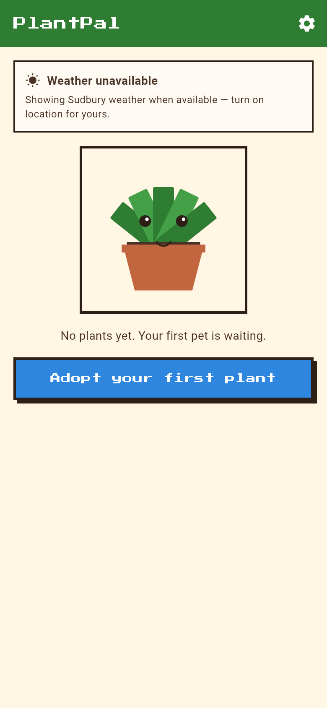

# PlantPal

Your plant, as a little pixel pet that tells you when it needs water.

Take a photo of your plant and PlantPal turns it into a 16-bit pet that
lives on your home screen. When the pet looks droopy, it is thirsty.
When it is bouncy and bright, it is happy. Tap "I watered it" and the
pet perks right back up. No schedule to remember, no account to make,
no data leaving your phone.

Built by VN. Free, no ads, no signups, no keys.

## Screenshots

Home screen (empty state) from the finished build — the code-drawn
sample pet, the weather badge with its honest Sudbury fallback note,
and the adopt call to action. Not a mockup: this is the app's own
home screen, rendered from the release build.



## How it works

1. **Adopt.** Photograph your plant, or pick a photo from your gallery.
   PlantPal pixelates it into a chunky 16-bit avatar. Your original
   photo stays on your device.
2. **Answer two questions.** Was it just watered? And how does the
   soil feel — dry, moist, or wet? Pick a species from a short list,
   or "I don't know" if you are not sure. Give your plant a name.
3. **Glance at the pet.** That is the whole routine. The pet shows
   its real state: happy when watered on time, restless when watering
   is due soon, droopy and thirsty when it is overdue.
4. **Water it, tap the button.** The clock resets, the pet celebrates
   with droplets and sparkles, and you are done until next time.

## What the pet reacts to

The pet is not decoration — every animation means something real,
and when two things compete, this is the order that wins:

**night (sleeping) > overdue/thirsty > due-soon/restless > weather > battery**

| What is happening | What the pet does |
| --- | --- |
| Watered on time | Happy: bounce, bright eyes, the odd sparkle |
| Watering due within 24 hours | Restless: slower bounce, glances at the water can |
| Watering overdue | Thirsty and droopy: leaves hang, colours dull |
| Just watered | Celebration: droplets, a jump, sparkles, then happy |
| Phone battery high (about 70%+) | Energetic: faster bounce, perkier idle motion |
| Phone battery low (under about 20%) | Sleepy and droopy: slow blink, heavy eyelids |
| Sunny | Basking: face tilted up, relaxed sway |
| Windy | Swaying with the wind, leaves fluttering |
| Rain | Raindrops on the pet, leaves perk up a little |
| Snow | Shivering: a tiny tremble, huddled leaves |
| Night | Sleeping: closed eyes, slow breathing, pixel "Z"s |
| Battery unknown (web, where the battery API may not exist) | Neutral energy — never a made-up battery level |

## Watering, in plain words

Everything is worked out on your device from dates you can see.
There is no server clock and no sync.

- Each species has a starting interval — pothos, snake plant, spider
  plant, monstera, peace lily, succulent/cactus, fern, fiddle-leaf
  fig, philodendron, ZZ plant, aloe vera, jade plant, calathea,
  rubber plant, dracaena, bird of paradise, English ivy, plus
  "Other / I don't know" at a cautious 7 days. Intervals are
  starting points, not gospel: every plant screen shows the
  interval and lets you change it.
- How the soil feels at setup shifts the first due date:
  dry brings it 2 days sooner (never less than 1 day away),
  moist keeps the default interval, wet pushes it 2 days later.
- If you did not just water it at setup, the first reminder is an
  estimate and the app says so plainly. Tap "I watered it" once and
  the real clock starts.
- After that: `next watering = last watered + interval`. "Due soon"
  means within 24 hours; "overdue" is counted in whole days.
- Watering early just resets the clock from the new date. Changing
  the interval recomputes the next date from the last watering and
  shows you the new date before you confirm. Dates are stored in UTC
  and shown in your local time, so travel does not break them.
- Got more than one plant? Each has its own pet, its own clock, and
  its own reminder. The home screen is a shelf of pets.

## More than watering

Other plant apps keep every rhythm separate instead of folding
everything into one interval, and PlantPal now does the same:

- **Other care tasks.** On a plant screen, add fertilize, mist,
  rotate, prune, or repot, each with its own interval and its own
  due date in plain words. Tap Done and its clock resets. On
  Android each task gets its own reminder, on its own
  notification id, so it never overwrites the watering reminder.
  Watering is still the main clock — the pet's mood still follows
  watering first, then weather, then battery.
- **Streak.** The plant screen shows how many waterings in a row
  were on time. A plant that is overdue right now has a streak
  of 0: the streak broke when it went overdue, and the next
  on-time watering starts a new one. No score, no points, just
  the count, derived from the watering history already on the
  device.
- **Notes.** One free-text note per plant — soil mix, pot
  changes, which window it likes. It lives with the plant and
  is deleted with it.
- **Search, sort, and coming up.** The home shelf can be
  searched by name and sorted by due date, name, or newest.
  Below the weather badge, "Coming up this week" lists the
  plants due in the next 7 days (overdue pets already shout
  from the shelf itself, so they are not repeated there).
- **Learning, on-device.** After 4 waterings, the plant screen
  shows what PlantPal has learned from your own watering
  history: the median gap between real waterings, not the mean,
  so one late watering on holiday does not drag the suggestion
  around. If that rhythm differs from your schedule by at least
  2 days, it offers a new interval — and nothing changes unless
  you tap it. No photo identification, no disease diagnosis, no
  model, no cloud: that kind of "AI" would need a dataset
  PlantPal does not have, and a wrong guess would be worse than
  no guess.
- **Snooze.** When a plant is due soon or overdue, the plant
  screen offers "Remind in 1 day" or "Remind in 3 days". That
  moves the reminder only — it does not record a watering, so
  history, streak, and the learned rhythm stay honest.
  Watering clears a snooze, and a snooze can be cancelled.
  A snooze never pulls a future due date earlier.

## Look, feel, and motion

- Shelf cards are rounded with a soft shadow and a ripple on
  tap, instead of flat bordered boxes.
- Every screen change uses the same short transition: a fade
  plus a small upward slide (300ms in, 250ms back), instead of
  the generic Android slide from the right.
- The pet itself animates between screens: tapping a shelf card
  grows that pet into the big plant-screen pet (a Hero
  animation), and back again when you go back.
- The due badge fades between states (watered, snoozed,
  interval edited) instead of swapping text in a hard cut.
  Colour is still never the only signal — the badge text
  always says the state in plain words.

## Weather and location

Weather comes from Open-Meteo — free, no account, no key. If the
network fails, the pet falls back to time of day only (day or night)
and the badge says weather is unavailable. Watering never depends on
weather.

Location is used only if you allow it. Otherwise the app shows
Sudbury, Ontario weather and says so in plain words: "Showing
Sudbury weather — turn on location for yours." It never pretends a
fallback is your local weather.

## Your photos and plants stay on your device

- Plants, watering history, and settings live in local on-device
  storage only.
- The original photo and the pixelated avatar live in the app's
  private documents folder. They are never uploaded, because there
  is no server to upload them to. The only network call in the app
  is the Open-Meteo weather fetch.
- Deleting a plant deletes its photo and avatar too. Nothing is left
  behind.
- **Backup, without a cloud.** Settings has Export backup and
  Import backup. Export copies your plants, care tasks, notes,
  settings, and pixel pets as plain text you keep yourself — a
  note, an email to yourself, a file. Import first checks the
  text, shows you how many plants it holds and their names, and
  only then replaces your current plants, and only if the backup
  fully validated. A bad paste changes nothing.
- One honest trade-off, still: a backup does NOT hold your
  original photos (a photo per plant would turn a backup into
  megabytes of text no one can paste reliably). After a restore
  your pixel pets look the same, but the original photo on each
  plant screen is gone. There is still no cloud copy — that is
  the price of keeping everything local, and it is stated here
  rather than buried.

## Sound, motion, and the off switch

PlantPal leans into chunky pixel effects — droplet particles and a
rising blip when you water, sparkles when the pet is happy, rain and
snow that match the weather, a press-down bounce on every button.
But effects are never the only signal: every state also has words
("2 days overdue"), and colour is never the only clue.

- Sound can be turned off in Settings, and off means off — including
  the watering celebration.
- If your system is set to reduced motion, idle animation drops to a
  gentle bob.
- All sounds are short original blips. There is no music loop and no
  recorded voice in v1.

## Install and run

You need the Flutter SDK. From the repo root:

```sh
flutter pub get
flutter analyze        # must be clean before any change lands
flutter run            # Android device/emulator, or web with -d chrome
flutter build web      # web build; must succeed locally
```

### Android APK

APK builds do **not** run on every machine. On this project's usual
dev box the sandbox blocks the connections Gradle needs, so
`flutter build apk` fails there no matter what — do not burn time
retrying it or working around the sandbox.

APKs are built on GitHub Actions instead: pushing a tag runs
`.github/workflows/build-apk.yml`, which builds the release APK and
attaches it to the release. The web build deploys to GitHub Pages
via `.github/workflows/pages.yml`. Neither workflow uses secrets:
Open-Meteo needs no key, and there is nothing to put in repository
secrets. If a future step ever asks for a key, stop — it does not
belong in this app.

## Android vs web

| | Android | Web |
| --- | --- | --- |
| Camera and gallery | Full support | File pick where camera is unavailable |
| Reminders | Local notifications on the device | Due state shown loudly in-app on open; optional browser notification only while the page is open |
| Battery reaction | Full support | Best effort; neutral energy when the browser cannot report it |
| Photos and plants | On-device | On-device (browser storage) |

No iOS build in v1. Android and web only, stated plainly so nobody
wastes time on a half-finished iOS setup.

## What PlantPal does not do (v1, on purpose)

- No accounts, login, cloud sync, or backend.
- No plant identification from a photo. You pick the species;
  "I don't know" is a proper answer, not a failure.
- No shop, ads, in-app purchases, or subscriptions.
- No social feed. Sharing a screenshot through your phone's share
  sheet is fine; it is not a feature to build around.
- No charts, graphs, or "plant health scores." Dates and plain
  words beat a made-up precision score.
- No sensors or automatic watering hardware. Soil moisture is what
  you feel and tap, not a probe reading.
- No reminders by email or SMS. Local notifications and the in-app
  due state only.
- No copied art. Every avatar is drawn in code from your own photo;
  sample pets are code-drawn too.

Anything beyond this list needs a plan update and a reason, not a
quiet addition in a pull request. See [PLAN.md](PLAN.md).

## Tech

- **Flutter + Dart** — one codebase, Android APK and web.
- **On-device storage** — local persistence for plants, history,
  and settings (one store, documented in code).
- **Open-Meteo** — free weather, no key, no signup, with a
  10-second timeout and a cached last-good forecast.
- **Pixel art in code** — photos are downscaled to a small grid and
  snapped to a fixed palette, hard edges, no smoothing. Eyes and
  expressions are drawn at render time, so mood changes never need
  a re-pixelate.
- **Dependencies kept short** — only well-maintained, openly
  licensed packages, each justified in pubspec comments: image
  picking, local storage, local notifications, battery, HTTP, and a
  pixel font. No analytics, no crash reporting, no ads SDK, no auth
  package — there is nothing to authenticate against.

## Project layout

```
plantpal/
  PLAN.md                 Spec, behaviour matrix, watering rules, release checklist
  README.md               This file
  LICENSE                 MIT
  pubspec.yaml
  lib/
    models/               Plant, species table, weather snapshot
    services/             Storage, watering math, weather, battery,
                          notifications, pixelate pipeline
    widgets/              Animated pet, pixel buttons, weather badge
    screens/              Home shelf, adopt flow, plant detail, settings
  test/                   Watering math, moisture shifts, UTC handling,
                          behaviour priority, weather mapping, species
                          table, pixelate pipeline, store round trip,
                          water tap, interval edit
  assets/
    fonts/                Pixel font (open licence, licence file kept)
    sfx/                  Short original blips
    screenshot.png        Real capture, added at release — never a mockup
  .github/workflows/
    build-apk.yml         Release APK on GitHub Actions runners
    pages.yml             Flutter web to GitHub Pages
```

## Contributing

Small, honest changes welcome: a corrected species interval with a
source you can point to, a bug fix with a test, a clearer line of
copy. Keep the dependency list short, keep `flutter analyze` clean,
and keep every new feature inside the v1 scope above — or update
PLAN.md first and say why.

## License

MIT — see [LICENSE](LICENSE). Use it, change it, make it yours.

---

— VN
